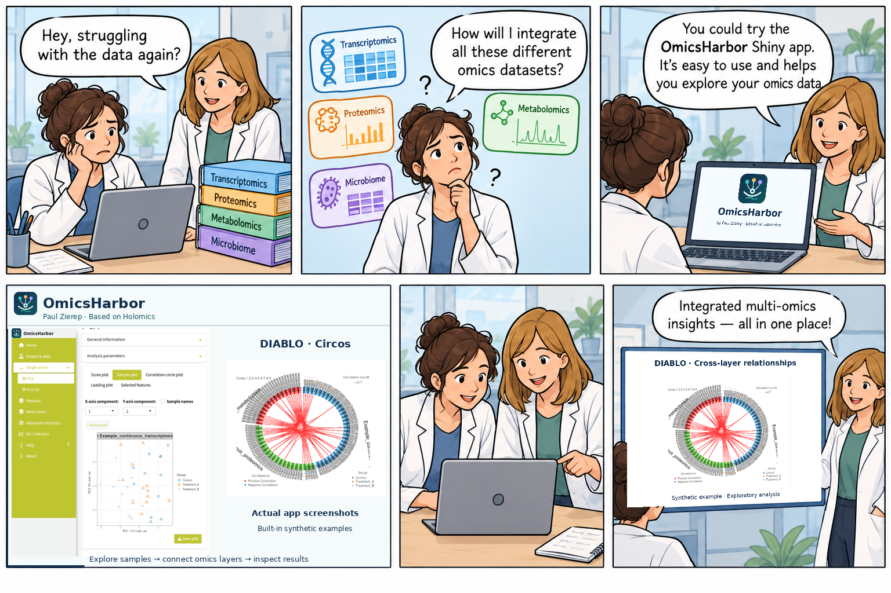

<!-- README.md is generated from README.Rmd. Please edit that file. -->

# OmicsHarbor


**A multi-omics analysis workspace by Paul Zierep, based on a fork of [Holomics](https://github.com/MolinLab/Holomics).**

[](LICENSE.md)
[](https://github.com/paulzierep/Holomics/tree/omicsharbor-development)

OmicsHarbor extends the original Holomics R Shiny application with guided
project setup, differential association analysis, an expanded mixOmics
workbench and Galaxy integration. It retains the original single- and
multi-omics workflows while providing a broader workspace for exploring
matched omics measurements and sample metadata.

This is an **independent development fork**, not an official Holomics release
or an endorsement by its original authors. The application is named
**OmicsHarbor**; the internal R package remains **`Holomics`** for compatibility.
CRAN's Holomics release does **not** contain these fork-specific additions.



*Illustrated introduction featuring real OmicsHarbor screenshots and the app's
harbour logo. Plots use the built-in synthetic examples, not study results.*

[View the full-size app screenshot](docs/images/omicsharbor-pca.png).

## What's in this fork?

| Area | Capabilities |
| --- | --- |
| Project & data | Guided setup, example datasets, omics blocks, labels and sample metadata |
| Single-omics | Original PCA and PLS-DA exploration, feature selection and tuning |
| Pairwise integration | sPLS analysis of two matched omics layers |
| Multi-omics integration | DIABLO integration, tuning and cross-layer visualizations |
| Differential association | Covariate-aware interfaces for MaAsLin3, limma, edgeR, DESeq2, ANCOM-BC2 and linear/mixed models; availability depends on installed packages |
| Advanced workbench | Additional mixOmics methods, including study-aware MINT routes |
| Results & Galaxy | Plot/table exports, optional Galaxy data staging and workspace checkpoints |

See the in-app Help and worked examples for input requirements and method
selection, and [GALAXY.md](GALAXY.md) for the Galaxy integration contract.

## Install and run

Install **this branch explicitly**; installing Holomics from CRAN or the upstream
repository launches the original application instead.

```r
install.packages(c("remotes", "BiocManager"))
BiocManager::install(c("mixOmics", "BiocParallel"), ask = FALSE)
remotes::install_github(
  "paulzierep/Holomics",
  ref = "omicsharbor-development",
  dependencies = NA,
  upgrade = "never"
)
Holomics::run_app()
```

Use an R/Bioconductor combination compatible with the mixOmics version you
install. The package's minimum R version alone is not a guarantee that all
optional backends support that R version. The install above installs required
dependencies, not every optional analysis backend.

For optional differential association methods, install the packages needed
for your analysis in the same R library, for example:

```r
BiocManager::install(c("limma", "edgeR", "DESeq2", "sva", "ANCOMBC"), ask = FALSE)
install.packages("lmerTest")
```

MaAsLin3 also requires its own installation and compatible dependencies; the
tested MaAsLin3 1.5.8 setup requires `mirai >= 2.5.0`. See
[the dependency repair script](tests/install-preview-dependencies.R) for the
specific preview environment, not a universal installation recipe.

For reproducible analyses, record the exact Git commit, `sessionInfo()`, input
preprocessing and analysis settings. This development branch is moving; pin a
reviewed commit rather than relying on the branch name for a published analysis.

## First analysis

1. Open **Project & data** and load an example or your own omics tables.
2. Check sample identifiers, table orientation, metadata and class labels.
   Normalize or transform measurements appropriately for the chosen method.
3. Start with **Single-omics → PCA** to inspect variation and potential outliers.
4. Choose PLS-DA for supervised single-layer exploration, sPLS for two-layer
   relationships, or DIABLO for supervised multi-layer integration.
5. Use differential association when you need feature-wise effects adjusted
   for covariates; use Advanced methods only when their data/design assumptions
   match your study.
6. Inspect diagnostics and export results together with their settings.

Exploratory separation and tuned training results are **not independent
predictive validation**. Avoid outcome leakage, use appropriate held-out or
nested validation, and review convergence and model assumptions.

## Development and validation status

OmicsHarbor is under active development. Backend fits and selected browser
workflows have been exercised, but this does **not** certify every method,
parameter combination or Galaxy deployment. Advanced/MINT browser coverage
remains incomplete, and some sPLS tuning candidates emit convergence warnings.
Detailed evidence and outstanding limitations are recorded in
[tests/STABILIZATION-STATUS.md](tests/STABILIZATION-STATUS.md).

### Two separate branches

- **`omicsharbor-development`** — this enhanced OmicsHarbor workspace.
- **`galaxy-it-adaptations`** — original Holomics with minimal Galaxy integration.
  Its container and acceptance results must not be taken as an OmicsHarbor release.

## Authorship and upstream credit

**OmicsHarbor development and fork-specific extensions: Paul Zierep
([@paulzierep](https://github.com/paulzierep)).**

OmicsHarbor is derived from **Holomics**, developed by **Katharina Munk and
Eva M. Molin**, with contributions from **Lisa Ziemba** and **Günter Brader**.
Original attribution and copyright notices are retained. The underlying
statistical methods are provided by mixOmics and the other packages used in
each analysis; please credit those authors too.

## Citation

Credit OmicsHarbor by Paul Zierep with its repository URL and exact commit.
No separate OmicsHarbor publication or DOI is currently declared. Also cite:

> Munk, K., Ilina, D., Ziemba, L., Brader, G. & Molin, E. M. (2024).
> *Holomics — a user-friendly R shiny application for multi-omics data integration
> and analysis.* BMC Bioinformatics.
> [doi:10.1186/s12859-024-05719-4](https://doi.org/10.1186/s12859-024-05719-4)

Include the appropriate citations for mixOmics and any differential association
backends actually used.

## Feedback and license

Report **fork-specific issues** at
[paulzierep/Holomics/issues](https://github.com/paulzierep/Holomics/issues), stating
that you used `omicsharbor-development` and including your commit and R session
information. Please do not send fork-only problems to the upstream authors.

OmicsHarbor retains the upstream **GNU GPL version 3 or later** license.
See [LICENSE.md](LICENSE.md).
